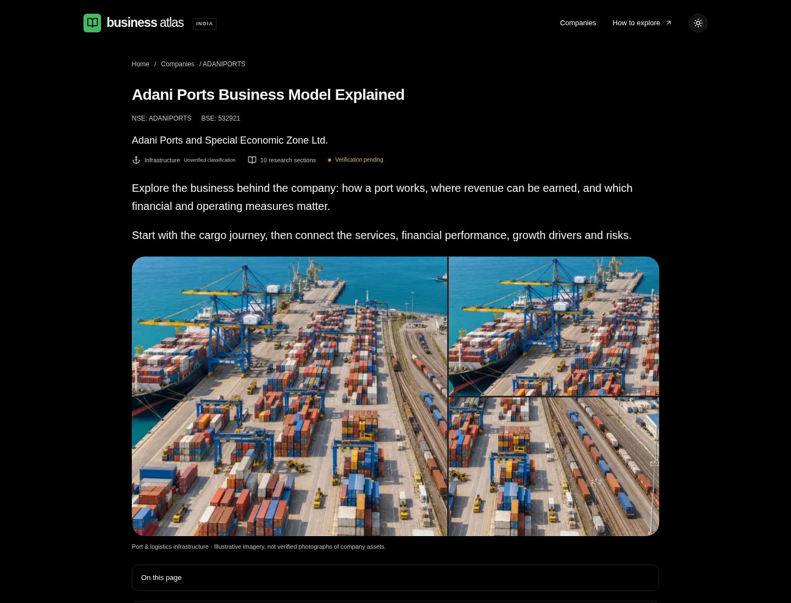

# Business Atlas

An Indian business encyclopedia prototype built around **one company: Adani Ports and Special Economic Zone Ltd.** No public deployment or stock-universe import has been performed.

The website is functional, but company research is **not verified or complete**. Official-site requests were blocked by the cloud network policy. The page distinguishes educational port-industry explanations, analytical frameworks and unverified company fields. Financial observations and references are deliberately empty. The NSE/BSE identifiers originate from the user’s brief, not an independent exchange check.

## Preview



[Business model](docs/screenshots/business-model.png) · [Cargo journey](docs/screenshots/cargo-journey.png) · [Financial cards](docs/screenshots/financial-cards.png)

These screenshots show the implemented dark reading layout. Imagery is illustrative and financial observations remain unverified.

For hosted setup and deployment troubleshooting, see [VERCEL.md](VERCEL.md).

## Run locally

Requires Node.js 24 and npm. Commands run from this repository root.

```sh
npm ci --cache /tmp/npm-cache
node scripts/setup-local.mjs
npm run db:local
```

Keep the database terminal running. It starts a real, persistent PostgreSQL instance on loopback port 54329, with data in ignored `.local/postgres`. The checked-in development database credentials are only for this loopback database; never use them for a hosted service. The setup helper creates an ignored `.env.local` with random admin and session credentials only if the file does not already exist. Set your own `ADMIN_PASSWORD` in that file; never commit it.

In a second terminal:

```sh
npm run db:migrate
npm run db:seed
npm run dev
```

Open the locally running application in your development browser on port 3000. `/` is the homepage, `/companies` the directory, `/companies/adani-ports` the research page and `/admin` the editorial workspace. Cloud onboarding does not provide a user-facing localhost preview link; screenshots are available under `.local`.

Migrations and the seed are repeatable. The seed does not overwrite existing research. Stop the servers with Ctrl+C. Start them again in each new task; filesystem snapshots do not retain processes. Use the existing checkout; a new Git worktree is unnecessary.

For an existing PostgreSQL database, set `DATABASE_URL` in secure runtime configuration and skip `db:local`. If using local files, `.env.local` takes effect in the Next.js server and the database scripts. Set `SITE_URL` to the canonical HTTPS origin before deployment. Hosted PostgreSQL should use its provider’s verified TLS configuration; do not disable certificate checking.

## Editorial workflow

Administration fails closed if the password or a 32-character session secret is absent. Enter the locally configured password at `/admin`. The single administrator can edit descriptions and sections, use the entry forms to add sections, sources, financial observations and permitted image references, use the advanced JSON editor for detailed changes, save drafts, preview, publish, and load previous revisions back into a draft. Company creation produces a blank unpublished profile. Do not expand company coverage before prototype approval.

Public pages query only the published JSON document; saving a draft cannot change it. Publication writes the draft and public version transactionally, records a revision and checks the expected version to reject concurrent overwrites. Every numeric observation must reference a source. Marking a claim verified requires a citation. Validation checks structure and references; human source verification is still required. Admin content is plain text, never executable HTML.

Image handling is **reference-only**, with an explicit permission statement. There is no file upload service. The `AP` monogram and port drawing are original interface illustrations, not company logos.

## Checks

Start PostgreSQL first. To run browser tests, build and start the application in a separate terminal before invoking Playwright:

```sh
npm run typecheck
npm run lint
npm test
npm run db:validate
npm run build
npm start
# In another terminal:
npm run test:e2e
```

Playwright uses `/usr/bin/chromium` in this environment. Set `CHROMIUM_PATH` on another machine. Browser tests exercise search, no-result states, mobile overflow, theme switching, the cargo diagram, anonymous write rejection, cross-origin login rejection and an authenticated save/preview/publish/restore workflow. They temporarily change and then restore the public description in the local test database; run against development data only. Screenshots are written to ignored `.local/`. Unit/database tests use rollback for database mutations. No invented financial observations are seeded.

## Import staging

```sh
npm run import:stage -- /path/to/authorized-batch.json 'Source description and permission record' --rights-confirmed
```

This accepts at most 500 rows, validates and normalizes identifiers, rejects conflicting listing identities, deduplicates rows, records errors and upserts a content-addressed staging batch. Re-running an identical batch returns the same audit record. **It never creates company records or publishes research.** There is no live exchange download or production promotion command. Exchange licensing, verified source adapters, a reviewed ISIN matching strategy and an approved rollback plan are prerequisites for the next phase. See the roadmap.

## Current limitations

- No audited financial history, segment revenue split, verified APSEZ segment structure, operating history, headquarters, official reference URLs or company-specific risk/advantage research. No invented values substitute for these gaps.
- Sector, industry, index and market-cap browsing are entry points with explicit verification messages; numeric/classification filters cannot operate until reliable metadata exists.
- Historical financial chart infrastructure renders only after sourced observations are entered. Missing observations are not zeros.
- Single-admin authentication is suitable for this private prototype. Multi-user roles, MFA, shared durable rate limiting, backups, operational monitoring and deployment-specific security review are future work before public production use.
- SSR and bounded/paginated directory queries are implemented. There is no external search service or production benchmark for thousands of companies. Add PostgreSQL trigram indexes after measuring real search workloads.
- No AI features, trading signals, recommendations, full-universe import or public deployment.

See [ARCHITECTURE.md](ARCHITECTURE.md), [DATABASE_SCHEMA.md](DATABASE_SCHEMA.md), [DEVELOPMENT_ROADMAP.md](DEVELOPMENT_ROADMAP.md) and [VALIDATION.md](VALIDATION.md).
